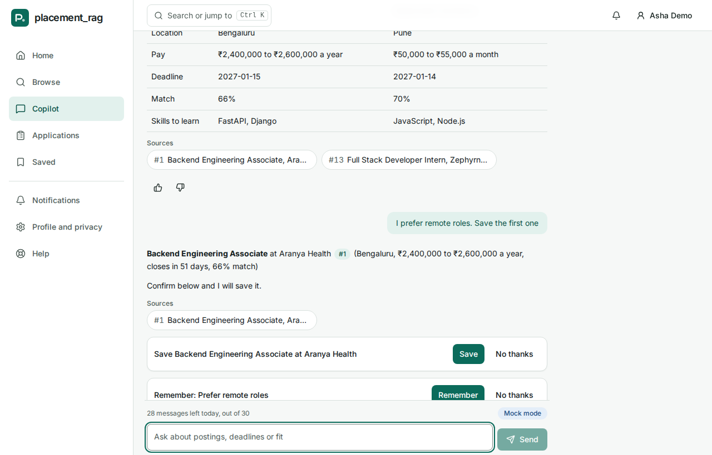
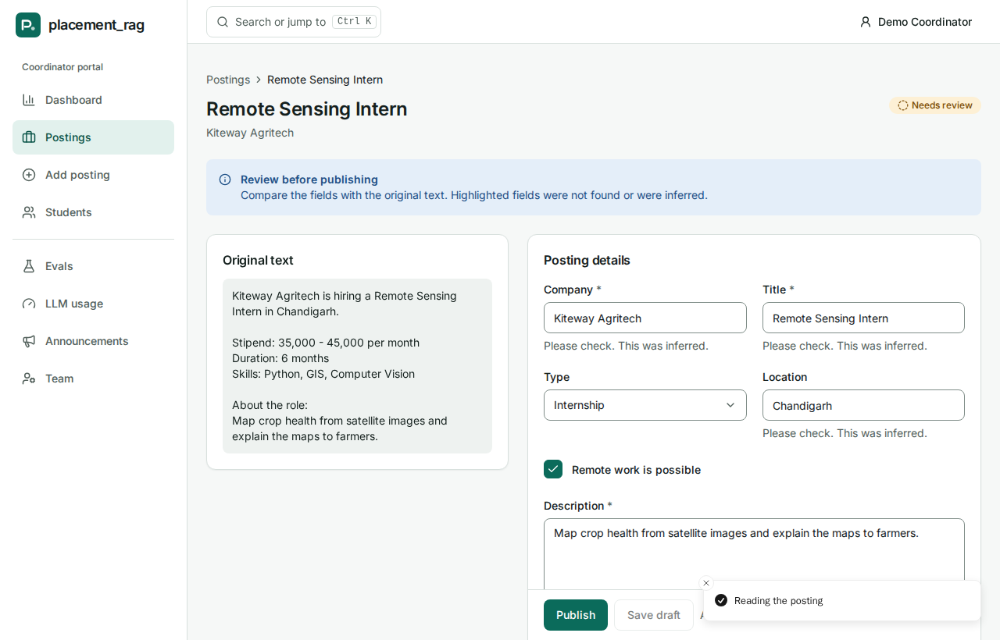
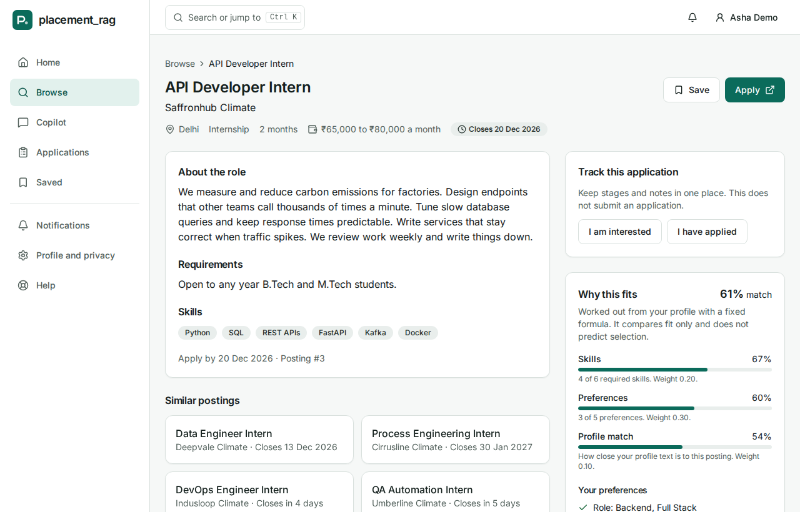
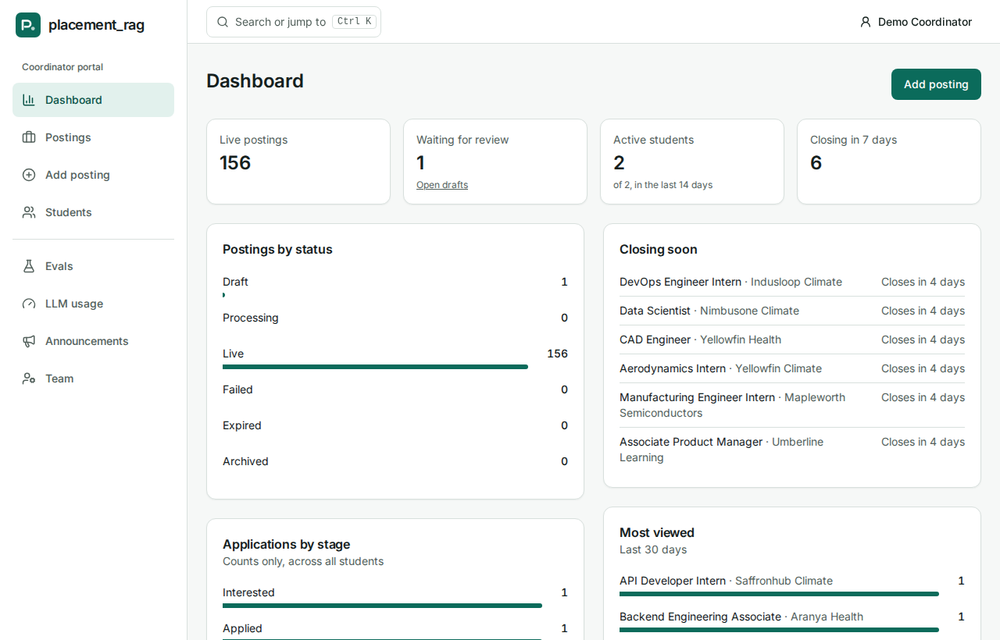
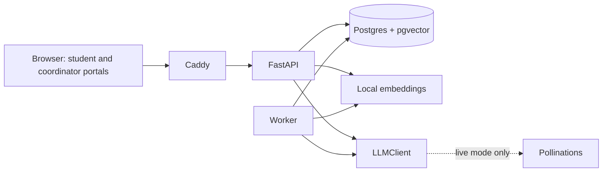

# placement_rag

An internship and placement copilot for IIT Ropar: hybrid search with explainable ranking, a grounded
tool-using agent, and two portals on one Postgres database.

[](https://github.com/shlok165/placement_rag/actions/workflows/ci.yml)
[](LICENSE)


| Student portal | Coordinator portal |
|---|---|
|  |  |
|  |  |

All data shown is synthetic.

## Features

**Students**

- Resume upload with identifiers removed first; the exact stored text is shown
- Search by meaning and by keyword, filters, saved searches, ranking by own profile
- "Why this fits": score breakdown and skill gap, computed without an LLM
- Copilot chat: streamed, cited, stoppable, asks before it saves or changes anything
- Memory the student confirms, edits and deletes fact by fact
- Application tracker (board or list) with undo, deadline reminders, alerts for new matches
- Consent, data export and full account deletion

**Coordinators**

- Add postings by form, pasted text, PDF or DOCX, or CSV
- Review parsed fields beside the original, with confidence flags and duplicate warnings
- Bulk actions, change history, retry, expiry, archive with undo
- Dashboard with content gaps, LLM usage and budget, announcements, team invites
- Eval workspace: cases, retrieval runs, and student feedback turned into cases

## Quickstart

```sh
git clone https://github.com/shlok165/placement_rag.git && cd placement_rag
cp .env.example .env
docker compose up --build -d --wait
```

Open <http://localhost:8080>. No key is needed: the default is mock mode, where a rule-based assistant
uses the same tools over the same postings.

| Demo account (local demo only) | Email | Password |
|---|---|---|
| Coordinator | `coordinator@example.com` | `demo-pass-2026` |
| Student with a profile | `asha@example.com` | `demo-pass-2026` |
| Student, before onboarding | `ravi@example.com` | `demo-pass-2026` |

**Live mode.** In `.env`, set `LLM_MODE=live`, `LLM_API_KEY` and `LLM_MODEL` (a name listed by
`GET https://gen.pollinations.ai/v1/models`), then run `docker compose up -d`. Daily and total caps
apply; see `.env.example`.

**Production.** Set `SITE_ADDRESS` and `POSTGRES_PASSWORD`, then run
`docker compose -f docker-compose.yml -f docker-compose.prod.yml up -d --build --wait`. Create the
first coordinator with
`docker compose exec backend python -m app.cli create-coordinator <email> "<name>"`.

`make` targets: `up`, `down`, `test`, `lint`, `migrate`, `seed`, `eval`, `eval-live`, `e2e`, `backup`,
`restore`.

## Architecture



| Layer | Choice |
|---|---|
| Backend | Python 3.12, FastAPI, Pydantic, SQLAlchemy, Alembic |
| Data | PostgreSQL 16, pgvector (HNSW), full-text search, queue with `SKIP LOCKED` |
| Embeddings | `BAAI/bge-small-en-v1.5` through fastembed, on the CPU, baked into the image |
| LLM | Pollinations, OpenAI-compatible, behind one budgeted client |
| Frontend | React, TypeScript, Vite, Tailwind, Radix, TanStack Query |
| Quality | pytest, Vitest, Playwright, axe, ruff, mypy, ESLint, GitHub Actions |

More in [docs/ARCHITECTURE.md](docs/ARCHITECTURE.md).

## How it works

**Retrieval.** Filters first, then 50 candidates from vectors and 50 from rarity-weighted full-text
search, fused by reciprocal rank. A transparent formula re-ranks them with the student's skills,
preferences and profile. The parts of the score are returned with every result.

**Agent.** A hand-written loop over eleven validated tools. The answer is itself a tool call. Before
any text is shown, code checks that each posting it cites came from a tool result in that turn and
that nothing predicts selection. Tools take the student from the session, never from the model.
Writes wait for a click.

## Evaluation

The dataset is **synthetic**: 156 generated postings and 77 labelled query and profile pairs. Numbers
compare configurations; they are not a forecast for real postings. Full tables, method and caveats
are in [docs/EVALS.md](docs/EVALS.md).

Retrieval, held-out half (38 cases, not used to choose weights), no LLM involved:

| Configuration | hit@1 | hit@5 | MRR | nDCG@10 | recall@50 |
|---|---|---|---|---|---|
| Semantic only | 0.711 | 0.895 | 0.799 | 0.670 | 0.888 |
| Keyword only | 0.500 | 0.632 | 0.562 | 0.476 | 0.752 |
| Hybrid | 0.658 | 0.868 | 0.754 | 0.676 | 0.897 |
| Hybrid + personal re-rank | 0.711 | 0.947 | 0.808 | 0.705 | 0.897 |

Plain hybrid beats semantic search on nDCG@10 and recall@50 but not on hit@1 or MRR. The re-rank
helps most on vague queries, and its labels there share facts with the ranker.

Copilot:

| Measure | Live model (one capped run) | Mock mode (tests plumbing only) |
|---|---|---|
| Right tool and arguments | 28 of 28 | 28 of 28 |
| Honest refusals | 9 of 10 (one rejected by the provider) | 10 of 10 |
| Answers shown with an ungrounded posting | 0 of 37 | 0 of 38 |
| Valid structured output | 25 of 37 | 38 of 38 |
| Judge, relevance and helpfulness (1 to 5, 9 answers, same model as judge) | 4.78 and 4.56 | not run |
| Live calls | 88 of 150 allowed | 0 |

## Design decisions and limits

- **One database.** Vectors, text index and rows change in one transaction, so a removed posting is
  gone from search at once. Built for thousands of postings, not millions.
- **Verify, then stream.** Answers are checked before the first word is shown. It costs some latency
  and means an invented posting is never displayed.
- **Budget first.** Cache, caps, quotas and a full mock mode are part of the product, not test tools.
- **Structured output is imperfect live.** In 12 of 37 turns the model answered in plain text. The
  checks still ran, but those answers have no suggested follow-ups.
- **Redaction is pattern based** and can miss unusual formats. Email ownership is not verified.
- **No real users yet.** No usability score is claimed.

Details: [decisions](docs/DECISIONS.md), [security review](docs/SECURITY.md),
[HCI review](docs/HCI.md).

## Roadmap

- Force the structured answer where the model supports it, and measure again
- Institute single sign-on and verified email
- Usability test with students and a reported SUS score
- Labels from real, consented search logs

## License

[MIT](LICENSE)
