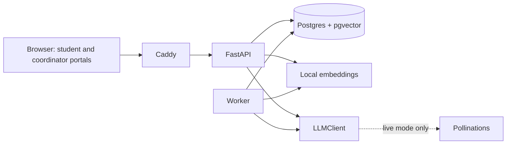

# placement_rag

An internship and placement copilot for IIT Ropar: hybrid search with explainable ranking, a grounded
tool-using agent, and two portals on one Postgres database.

[](https://github.com/shlok165/placement_rag/actions/workflows/ci.yml)
[](LICENSE)


| Student portal | Coordinator portal |
|---|---|
|  |  |
|  |  |

All data shown is synthetic.

## Features

**Students**

- Resume upload with identifiers removed first; the exact stored text is shown
- Search by meaning and by keyword; typed requests such as "remote ML internship in Pune, above
  30k" become filters the student confirms as chips
- Saved searches, ranking by own profile, and "more or fewer like this" that the ranking learns from
- "Why this fits": score breakdown and skill gap, computed without an LLM
- Copilot chat: streamed, cited, stoppable, asks before it saves or changes anything
- Recruiter notes and resume advice drafted from the profile and the posting only, checked for
  invented claims, shown to edit and copy, never sent
- Memory the student confirms, edits and deletes fact by fact
- Application tracker (board or list) with undo, deadline reminders, alerts for new matches
- Deadlines as an .ics download or a private calendar link that can be revoked
- Consent, data export and full account deletion

**Coordinators**

- Add postings by form, pasted text, PDF or DOCX, or CSV
- Review parsed fields beside the original, with confidence flags and duplicate warnings
- Bulk actions, change history, retry, expiry, archive with undo
- Dashboard with content gaps, LLM usage and budget, announcements, team invites
- Eval workspace: cases, retrieval runs, and student feedback turned into cases
- Agent traces: the tools, checks, timing and cache hits behind an answer a student chose to share

## Quickstart

```sh
git clone https://github.com/shlok165/placement_rag.git && cd placement_rag
cp .env.example .env
docker compose up --build -d --wait
```

Open <http://localhost:8080>. No key is needed: the default is mock mode, where a rule-based assistant
uses the same tools over the same postings.

| Demo account (local demo only) | Email | Password |
|---|---|---|
| Coordinator | `coordinator@example.com` | `demo-pass-2026` |
| Student with a profile | `asha@example.com` | `demo-pass-2026` |
| Student, before onboarding | `ravi@example.com` | `demo-pass-2026` |

**Live mode.** In `.env`, set `LLM_MODE=live`, `LLM_API_KEY` and `LLM_MODEL` (a name listed by
`GET https://gen.pollinations.ai/v1/models`), then run `docker compose up -d`. Daily and total caps
apply; see `.env.example`.

**Production.** Set `SITE_ADDRESS` and `POSTGRES_PASSWORD`, then run
`docker compose -f docker-compose.yml -f docker-compose.prod.yml up -d --build --wait`. Create the
first coordinator with
`docker compose exec backend python -m app.cli create-coordinator <email> "<name>"`.

`make` targets: `up`, `down`, `test`, `lint`, `migrate`, `seed`, `eval`, `eval-live`, `e2e`, `backup`,
`restore`.

## Architecture



| Layer | Choice |
|---|---|
| Backend | Python 3.12, FastAPI, Pydantic, SQLAlchemy, Alembic |
| Data | PostgreSQL 16, pgvector (HNSW), full-text search, queue with `SKIP LOCKED` |
| Embeddings | `BAAI/bge-small-en-v1.5` through fastembed, on the CPU, baked into the image |
| LLM | Pollinations, OpenAI-compatible, behind one budgeted client |
| Frontend | React, TypeScript, Vite, Tailwind, Radix, TanStack Query |
| Quality | pytest, Vitest, Playwright, axe, ruff, mypy, ESLint, pip-audit, npm audit, Trivy, GitHub Actions |

More in [docs/ARCHITECTURE.md](docs/ARCHITECTURE.md).

## How it works

**Retrieval.** Filters first, then 50 candidates from vectors (HNSW) and 50 from rarity-weighted
full-text search, fused by reciprocal rank. A transparent formula re-ranks them with the student's
skills, preferences, profile and, once they have saved or liked postings, their taste. The parts of
the score are returned with every result.

**Agent.** A hand-written loop over twelve validated tools that must answer through a
`final_answer` tool call. Before any text is shown, code checks that each posting it cites came from
a tool result in that turn and that nothing predicts selection; outreach drafts must also pass a
fabrication check. Failed answers get one repair, then a fallback built by code. Tools take the
student from the session, never from the model. Writes wait for a click.

## Evaluation

The data is **synthetic**: generated postings and labelled query and profile pairs. Numbers compare
configurations; they are not a forecast for real postings. Method and caveats:
[docs/EVALS.md](docs/EVALS.md).

Retrieval on the **blind set** (104 postings and 50 queries written separately, run once for
v1.0.0, never used for tuning), with bootstrap 95% intervals. No LLM involved:

| Configuration | hit@1 | hit@5 | MRR | nDCG@10 |
|---|---|---|---|---|
| Semantic only | 0.700 [0.58, 0.82] | 0.780 [0.66, 0.88] | 0.747 [0.64, 0.85] | 0.679 [0.58, 0.78] |
| Keyword only | 0.700 [0.58, 0.82] | 0.860 [0.76, 0.94] | 0.758 [0.65, 0.86] | 0.729 [0.63, 0.82] |
| Hybrid | 0.640 [0.50, 0.76] | 0.880 [0.80, 0.96] | 0.741 [0.65, 0.83] | 0.733 [0.64, 0.82] |
| Hybrid + personal re-rank | 0.700 [0.58, 0.84] | **0.980** [0.94, 1.00] | 0.807 [0.73, 0.89] | **0.784** [0.71, 0.85] |

Against semantic search alone, the full pipeline gains +0.105 nDCG@10 (paired interval +0.04 to
+0.17). On the main set's held-out half the same comparison stays inside the noise. Messy text
(typos, "ML/AI", boilerplate) costs at most 0.04 nDCG@10. A cross-encoder re-rank lost on the
development half and is off. Saved-posting taste gives a small gain in a simulation with synthetic
students (MRR +0.010).

Copilot, one capped live run each:

| Measure | Round 1 (`338aae4`) | v1.0.0 | Mock mode (plumbing only) |
|---|---|---|---|
| Right tool and arguments | 28 of 28 | 27 of 28 | 28 of 28 |
| Honest refusals | 9 of 10 | 7 of 10 | 10 of 10 |
| Answers shown with an ungrounded posting | 0 of 37 | 0 of 46 | 0 of 47 |
| Valid structured output | 25 of 37 (68%) | **41 of 46 (89%)** | 47 of 47 |
| Draft requests with an invented claim shown | not tested | **0 of 9** | 0 of 9 |
| Drafts stopped by the fabrication check | not tested | 10 | 0 |
| Judge, relevance and helpfulness (same model) | 4.78 and 4.56 | 4.89 and 4.78 | not run |
| Live calls (cap 150) | 88 | 123 | 0 |

## Performance

`make bench`, in process, 500 distinct queries, mock mode, one laptop
([details](docs/PERFORMANCE.md)):

| Postings | Search p50 | p95 | Personalised p50 | HNSW recall@10 |
|---|---|---|---|---|
| 1,000 | 36 ms | 44 ms | 57 ms | 1.000 |
| 10,000 | 49 ms | 62 ms | 72 ms | 1.000 |
| 50,000 | 100 ms | 132 ms | 130 ms | 0.989 |

The benchmark found that vector search never used its index (a second sort key blocked it); the fix
halved latency at 50,000 postings.

## Design decisions and limits

- **One database.** Vectors, text index and rows change in one transaction, so a removed posting is
  gone from search at once. Measured to 50,000 postings.
- **Verify, then stream.** Answers are checked before the first word is shown. It costs some latency
  and means an invented posting or claim is never displayed.
- **Budget first.** Cache, caps, quotas and a full mock mode are part of the product, not test tools.
- **Refusals slipped live** (7 of 10): a fallback list instead of a "no", and a wrongly labelled
  reply. Drafts sometimes end without a draft box. Both are written up in the eval doc.
- **Checks are pattern based.** Redaction and the fabrication check can miss unusual formats or a
  claim without a name, number or skill. Email ownership is not verified.
- **No real users yet.** No usability score is claimed.

Details: [decisions](docs/DECISIONS.md), [security review](docs/SECURITY.md),
[HCI review](docs/HCI.md), [deployment guide](docs/DEPLOY.md).

## Roadmap

- Make "no" the answer when a request cannot be met, and get a clean draft into the box every time
- Break down the remaining search time at 50,000 postings and cache keyword document counts
- Re-test the cross-encoder on a larger, fresh blind set
- Institute single sign-on and verified email
- Usability test with students and a reported SUS score
- Labels and taste weights from real, consented usage
## License

[MIT](LICENSE)
