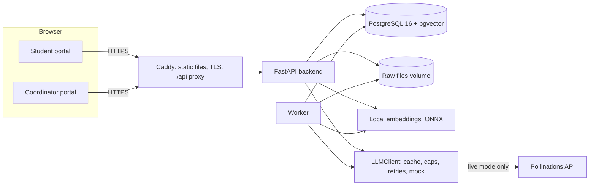
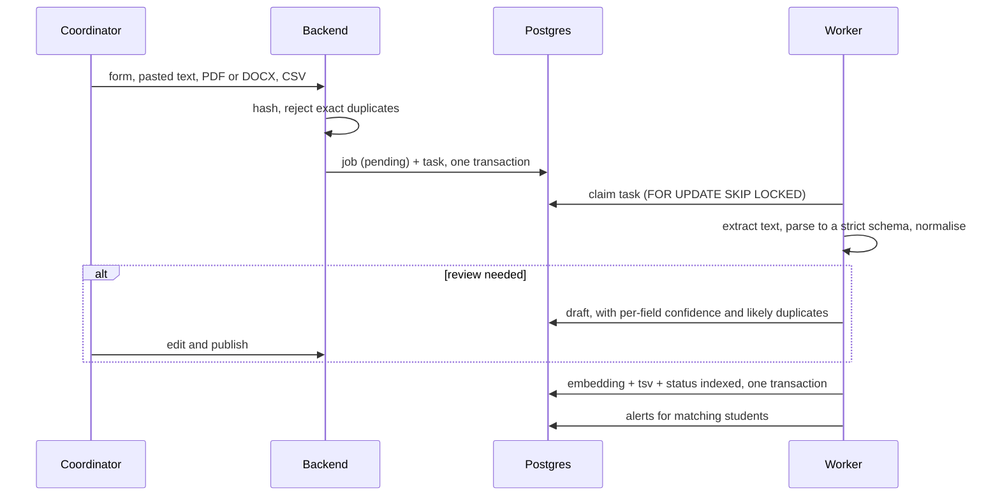

# Architecture

One codebase, one database, four containers (`db`, `backend`, `worker`, `frontend`).

## Ingest

- Edits to a live posting re-embed and rewrite `tsv` in the same transaction as the row.
- Failed input is reported once with a plain reason. Unexpected errors are retried with backoff.
- A task whose worker died is claimed again after ten minutes.
- Archiving or expiring changes `status`, and search filters on it, so the posting is gone at once.

## Search (`app/search`)

0. Typed words such as "remote ML internship in Pune" can be read into filters first
   (`nlq.py`, rules only). The student sees them as chips and confirms.
1. Filters: live, deadline not passed, plus type, place, remote, pay, closing window.
2. Candidates: 50 nearest by cosine distance through the HNSW index and 50 by full-text score. Each
   keyword is weighted by how rare it is, because Postgres ranking has no inverse document
   frequency. The vector query orders by distance alone so the index can be used.
3. Fusion: reciprocal rank fusion (or a weighted sum, by configuration). An optional cross-encoder
   stage can reorder the top 20; it is off because it lost in the evaluation.
4. Personal re-rank: search match, skill overlap, preference match, profile similarity, taste
   (closeness to postings the student saved, applied to or liked), and a small urgency nudge. The
   full breakdown is returned and shown to the student.

The taste vector (`taste.py`) is a decayed, weighted mean of the embeddings of postings behind
`save`, `apply_clicked` and `thumb_up` events, minus a smaller weight for `thumb_down`. With no such
events it does not exist and the score is computed exactly as without the feature.

All weights are in `app/search/weights.toml`. The module does not depend on the agent or the API.

## Agent (`app/agent`)

A short loop over the chat completions API: system prompt, memory, summary and recent messages, then
tool calls until `final_answer`. At most five steps and a token limit per turn.

Every call asks for a tool call (`tool_choice: "required"`) when the model list says the model
supports it. Before an answer is shown, code checks that every posting id came from a tool result
in that turn and that nothing predicts selection. A plain-text reply gets one request to resend it
as `final_answer`; a failed check gets one repair. After that the answer is built by code: the
plain text after the same checks, or a list from the tool results. Each stored answer records
which of these happened (`answer_kind`). Only then is it streamed.

`draft_outreach` hands the model the facts a recruiter note or resume advice may use. A draft in
`final_answer.draft` passes a deterministic fabrication check (`outreach.py`) or is not shown; the
fallback is a template built only from those facts.

Each turn stores its tool calls (with timings), checks, latency and cache hits. Coordinators can
read a turn in **Agent traces** when it is their own or a student shared it.

Tools take the student from the session. Their schemas reject unknown arguments, so a model cannot
pass a user id. Write tools only create a pending action, which the student confirms.

## LLM client (`app/llm`)

Everything goes through `LLMClient`: mock mode by default, response cache by content hash, an atomic
"count then reserve" against daily, total and per-eval caps, at most two retries on network errors,
429 and 5xx, prompt size limits, and a log row per call. Over budget it answers from the cache or the
rule-based fallback and says so.

## Data

Vectors, text search and rows live in one Postgres database, so removing a posting or an account is
one transaction. Uploaded files sit behind a small storage interface with generated names.
