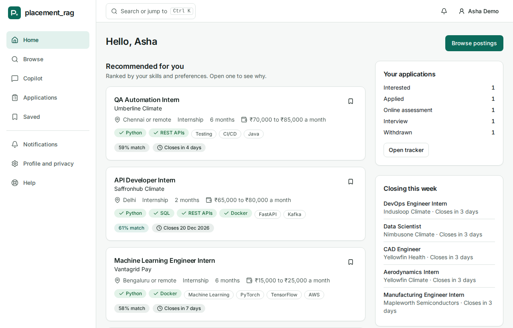
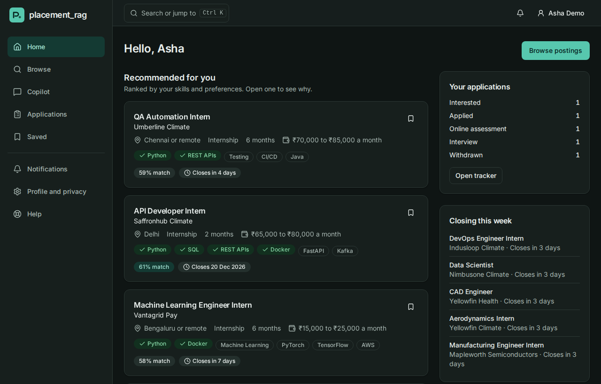
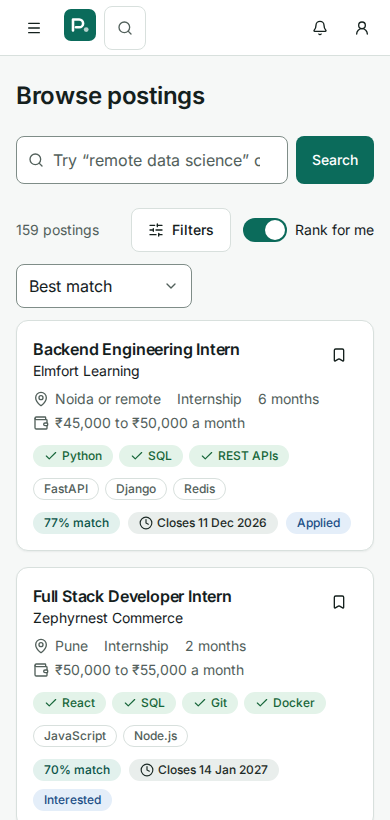
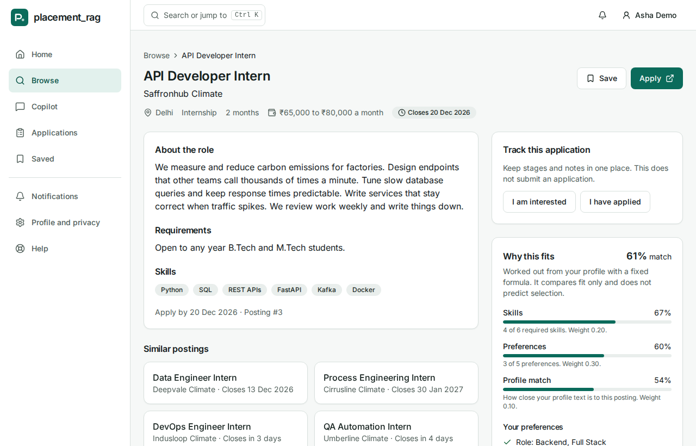
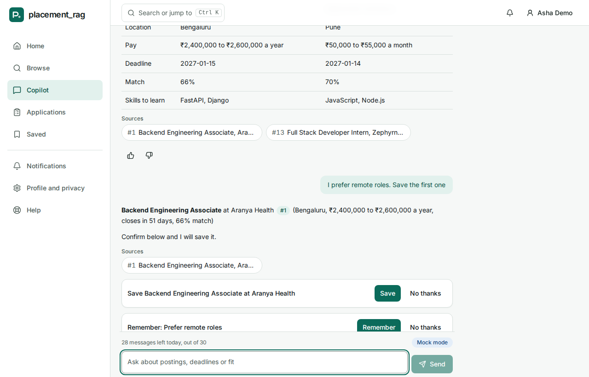
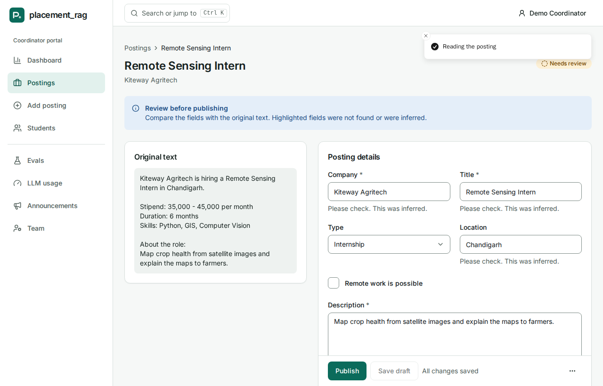
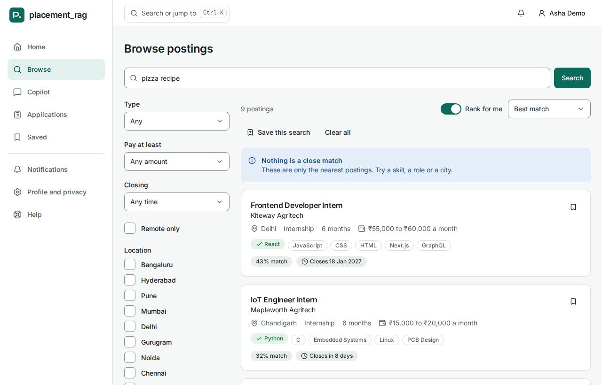
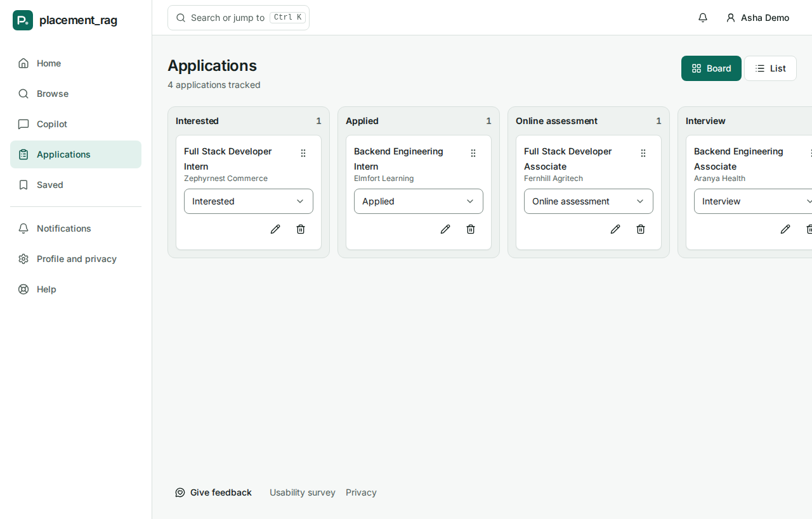
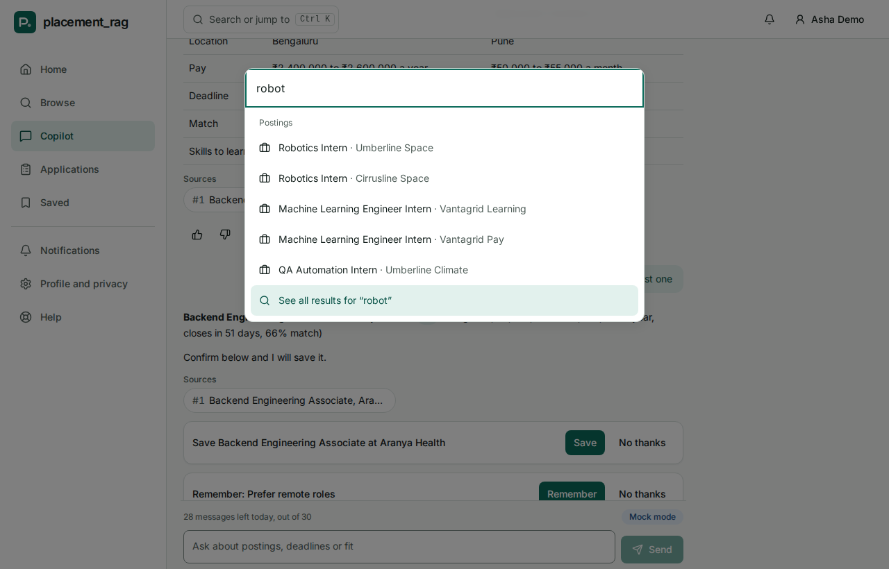
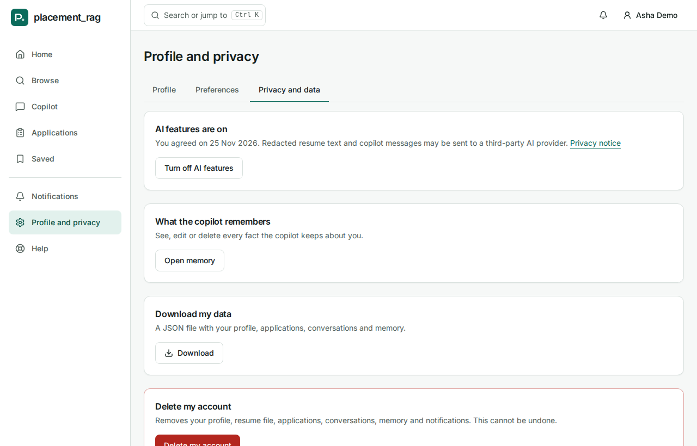

# HCI review

How the interface meets its design goals, with what was checked and what was found.

## Design system

Tokens for colour, type, spacing (8px grid), radius and elevation live in
`frontend/src/styles.css`, with a light and a dark theme and one accent colour. Components in
`src/components/ui` wrap Radix primitives; no menu, dialog, select or tooltip is hand-rolled. Text is
Inter, body copy is kept to a readable width, and buttons come in five variants.

| Light | Dark | Phone |
|---|---|---|
|  |  |  |

## Heuristic evaluation

Self-evaluation against Nielsen's ten heuristics on the finished interface.

| # | Heuristic | How it is met | Verdict |
|---|---|---|---|
| 1 | Visibility of system status | Skeletons, posting status from Processing to Live, named copilot steps, streamed text, messages left today, budget bar, "Unsaved changes" | Met |
| 2 | Match with the real world | "Live", "Closing soon", "Not selected"; rupees and lakh; no internal terms in student pages. Coordinator pages keep "hit@5" and "recall@50", which name standard metrics | Met, with that exception |
| 3 | User control and freedom | Undo on save, track, archive, expire; Stop while the copilot writes; Cancel on every dialog; form entries kept as a draft on the device | Met |
| 4 | Consistency and standards | One component set in both portals, same table-to-card pattern, native form controls | Met |
| 5 | Error prevention | Inline checks before submit, duplicate warning while typing, confirmation on destructive actions, disabled buttons explain why in their title | Mostly met: a title is not available on touch, so the most common cases also show text |
| 6 | Recognition over recall | Filters as chips, recent and saved searches, suggested prompts, breadcrumbs, labelled icons, shareable URLs for filters | Met |
| 7 | Flexibility and efficiency | Ctrl or ⌘ + K palette, / for search, bulk actions, saved searches | Met |
| 8 | Aesthetic and minimalist design | One primary action per view, score details in a side panel, filters in a sheet on phones | Met |
| 9 | Help with errors | Plain messages with a next step and a retry; no codes or traces | Met |
| 10 | Help and documentation | Help page, privacy notice, tooltips, five-step tour that can be skipped and reopened | Met |

## Evidence

**Why this fits** explains every part of the score and states what it is not.

**The copilot** shows sources, asks before changing anything and shows the messages left.

**Reviewing a parsed posting** puts the original beside the fields and marks what was inferred.

**Weak matches** are called weak instead of being presented as results.

**The tracker** can be used by dragging, or with the stage list on each card, or as a plain list.

**The command palette** reaches pages and postings from anywhere.

**Privacy controls** sit together: consent, memory, export, deletion.

## Accessibility

Checked in a real browser by `e2e/tests/a11y.spec.ts`, and per component with axe in unit tests.

| Check | Result |
|---|---|
| axe (WCAG 2.0 to 2.2 A and AA, plus best practices) on 16 public and student pages and 11 coordinator pages, light and dark | No violations |
| axe at phone width, with the menu and the palette open | No violations |
| No sideways scroll at 320px on 14 student pages | Passes |
| Interactive targets at least 24px (most are 40 to 48px) | Passes |
| Sign in, skip link, palette, search, open a posting, track and change stage, keyboard only | Passes |
| Visible focus ring of at least 2px | Passes |
| `prefers-reduced-motion` removes animation | Implemented |
| Live regions for chat, counts, errors and toasts | Implemented |

Automated checks find only part of all accessibility problems. No screen reader session with a real
user has been run.

### Found and fixed during the audit

- Skipped heading levels in search results and eval runs.
- The sidebar logo was outside any landmark; two side regions had no name.
- Invalid definition list in the fit panel.
- Copilot header overflowed at 320px.
- Toasts covered the sticky save bar, so they moved to the top.
- The last copilot card was hidden behind the message box.

## Added in round 2

| Feature | Design choice | Accessibility |
|---|---|---|
| Filters from typed words | "remote ML internship in Bangalore" is shown as chips (Remote, Internship, Bengaluru) with the remaining words, before anything is searched. Each chip can be removed; "Search my words as typed" ignores them all | The panel sits in a polite live region; chips are buttons named "Remove Remote"; targets are at least 28px |
| Outreach draft | Shown in an editable box under the answer, with Copy and "Undo my edits". The hint says it was checked and that nothing is sent | Labelled text area with a hint; the copy result is announced through a status region; copying that the browser blocks gets a plain fallback message |
| Calendar | Download an .ics file, or make a private subscription link that is shown once, can be replaced and turned off | Read-only labelled field that selects itself on focus; the copy result is announced |
| More or fewer like this | Two toggle buttons on a posting, pressed state visible and exposed as `aria-pressed`; pressing again undoes | Text labels, not icons alone; toasts confirm the change |
| Why this fits | "Similar to jobs you saved" appears only when saved postings moved the score | Same list pattern as the other parts |
| Share the steps | A checkbox in the rating dialog, off by default, says exactly what coordinators would see | Native checkbox with label and hint |
| Agent traces (coordinators) | A list of turns, then one turn's steps, checks and cost on one page | Table with header cells in a scrollable, focusable region; success and failure have text, not only colour |

## Other principles

- **Fitts and Hick:** primary actions are 40 to 48px tall; list views show one main action; filters
  default to "Any".
- **Gestalt:** related controls share a card; labels, hints and errors stay with their field.
- **Feedback timing:** save and track update at once and roll back on failure; lists keep old rows
  while new ones load; skeletons cover first loads.
- **Content:** empty states say what to do next. Errors say what happened and how to go on.
- **Trust:** the score states it does not predict selection; memory is confirmed fact by fact; the
  consent text says what is removed and what is sent.

## Usability testing

The portal has a feedback button on every page and a System Usability Scale survey at `/survey`.
Coordinators see the mean score under Announcements. **No test with students has been run yet, so no
SUS score is reported.**

A suggested session, about 20 minutes with five or more students:

1. Set up a profile without a resume.
2. Find a remote internship that fits and explain why it was recommended.
3. Ask the copilot to compare two postings and save one.
4. Move an application to Interview, then undo it.
5. Find out what the copilot remembers and delete one fact.
6. Fill in the survey.

Note task success, time, wrong turns and comments. Fix what two or more people stumble on.
